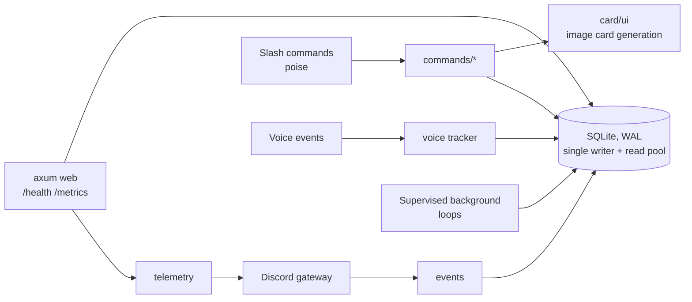

# tetbot

**A Discord bot that keeps your server lively: voice levels, a virtual economy, mini games played with virtual coins, creature hunting and radio, all in one place.**

Hi, this is the showcase repo for tetbot. The bot's source code lives in a private repo, so here I'm sharing what it does, how it works, my CI setup and one module I picked from the infrastructure.

> The coins, chips and credits in the bot are entirely virtual. They have no real-world value and can't be cashed out.

<!-- TODO: screenshot — /rank card -->
<!-- TODO: screenshot — arena (3v3) battle card -->
<!-- TODO: screenshot — /market and portfolio -->

## What it adds to a server

**Voice chat becomes a game.** I track the time people spend in voice channels. Everyone levels up and earns reward coins and voice milestone roles. Levels, rankings and battle results are generated as image cards.

**A server with its own economy.** Daily and weekly rewards, quests, a bank (checking and fixed-term accounts), transfers between users, loans with interest, and leaderboards for the richest and the biggest losers. Every server has its own market. Stocks fluctuate periodically, and you can trade them and track your portfolio.

**Plenty to play.**
- Mini games played with virtual coins (card and luck themed) and player-vs-player versus matches. No real money is involved.
- Community predictions: open a prediction, join with virtual coins, settle the result.
- Hunt: catch creatures, build a collection, form a team, upgrade it, enter 3v3 arena battles and open crates.

**Radio and music.** Play from a link or a search, with a queue, loop, volume and filters. You control playback with buttons on the player message. Some features are part of premium.

**Tools for server admins.**
- Join-to-Create: a temporary voice channel on demand, with a name and limit the owner can set. The channel is deleted when it empties.
- Role selection menus (selfrole), a role shop that sells roles for coins, roles tied to voice level, and a configurable welcome message.
- Web dashboard: bot status and statistics.

**Privacy and language.** With `/forgetme`, users can delete their own data. The bot speaks Turkish and English, based on the user's Discord language.

## Under the hood

- **Rust.** A single binary with low resource use, running asynchronously on Tokio.
- **Money safety.** All writes are queued through a single writer. Every balance change happens inside one transaction and leaves a ledger row.
- **Resilience.** A panic in one command only ends that task, and background loops restart themselves.
- **Observability.** A `/health` endpoint that knows about the gateway, and `/metrics` in Prometheus format.
- **Quality gates.** On every push: `clippy -D warnings`, tests, `cargo fmt` and `cargo deny`.
- **Deployment.** A Docker image (non-root user), a deploy with sha256 verification, and an automatic rollback if the health check fails.

## Stack

| Area | Choice |
| --- | --- |
| Language | Rust, edition 2024 |
| Discord | `serenity` 0.12 + `poise` 0.6 |
| Voice | `songbird` 0.6, `symphonia`, ffmpeg + yt-dlp |
| Database | SQLite, `sqlx` 0.8, WAL |
| HTTP | `axum` 0.7, `reqwest` 0.12 |
| Graphics | `image`, `imageproc`, `ab_glyph` |
| Infrastructure | Docker, systemd, GitHub Actions, Litestream (optional backup) |

## CI and tests

[`ci-reference/ci.yml`](ci-reference/ci.yml) is a copy of the GitHub Actions workflow from the private repo. On every push and pull request it runs:

- `cargo check --locked`, `cargo clippy --all-targets -- -D warnings`, `cargo test`, `cargo fmt --check`
- `cargo deny check advisories licenses` in a separate job (RustSec security advisories and the license policy)
- a release binary build and a Docker image build
- if fmt or clippy fails, the fix patches get uploaded as artifacts, so I can just apply them

The economy and schema migration tests run against a temporary SQLite file. The telemetry and web layers have their own unit tests.

<!-- TODO: CI badge or a screenshot of a successful run -->

## Example module: `src/telemetry.rs`

This is the bot's observability and resilience module. I removed the one economy-related metric (coin supply per server) and the database loop that feeds it, and the rest is the same as the module in the bot.

- **Gateway state:** samples the shards every 10 s. If the sample is older than 60 s, the connection counts as down.
- **Prometheus metrics:** command count, error count and a duration histogram. It uses atomic counters and a `DashMap` keyed by command name, and doesn't allocate any memory after the first call.
- **Panic hook:** logs every panic with its location and counts it.
- **`spawn_supervised`:** runs a background loop in its own task and restarts it after a panic, with a wait that doubles from 5 s up to 5 min. After 10 min without a panic, the wait resets.
- The module's own unit tests are at the end of the file.

Btw, this file isn't a standalone crate. It expects the `serenity`, `tokio`, `dashmap`, `tracing` and `serde` dependencies.

## License

MIT. See [LICENSE](LICENSE) for details.
