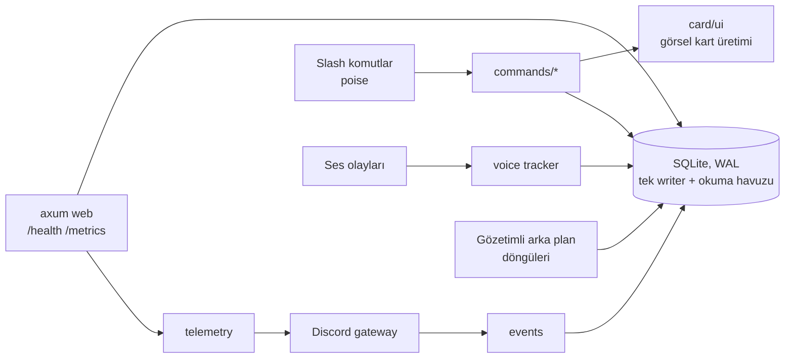

# tetbot

**Discord sunucunuzu canlı tutan bot: ses seviyeleri, sanal ekonomi, sanal coin ile oynanan mini oyunlar, yaratık avı ve radyo tek yerde.**

Bu repo tetbot'un vitrinidir. Botun kaynak kodu private repoda durur; burada neler yaptığı, nasıl çalıştığı, CI kanıtı ve altyapıdan seçilmiş bir modül var.

> Botdaki coin, chip ve kredi tamamen sanaldır; gerçek para değeri yoktur ve paraya çevrilemez.

<!-- TODO: ekran görüntüsü — /rank kartı -->
<!-- TODO: ekran görüntüsü — arena (3v3) savaş kartı -->
<!-- TODO: ekran görüntüsü — /market ve portföy -->

## Sunucuya ne katar

**Sesli sohbet artık bir oyun.** Ses kanalında geçirilen süre izlenir; herkes level atlar, ödül coini ve ses kilometre taşı rolleri kazanır. Level, sıralama ve savaş sonuçları görsel kartlar olarak üretilir.

**Kendi ekonomisi olan bir sunucu.** Günlük ve haftalık ödüller, görevler, banka (vadesiz ve vadeli hesap), kullanıcılar arası transfer ve faizli borç, zenginler ve kaybedenler tabloları. Her sunucunun piyasası ayrıdır; hisseler periyodik dalgalanır, alım satım ve portföy takibi yapılır.

**Oynanacak çok şey var.**
- Sanal coin ile oynanan mini oyunlar (kart ve şans temalı) ve oyuncular arası versus; gerçek para içermez.
- Topluluk tahminleri: tahmin aç, sanal coin ile katıl, sonucu belirle.
- Hunt: yaratık yakala, koleksiyon yap, takım kur, geliştir, 3v3 arena savaşına gir, kasa aç.

**Radyo ve müzik.** Link ya da aramadan çalma, kuyruk, loop, ses seviyesi ve filtreler; oynatma mesajı üzerinden butonlarla kontrol. Bazı özellikler premium kapsamındadır.

**Yönetici dostu araçlar.**
- Join-to-Create: istek üzerine geçici ses kanalı, sahibine özel isim ve limit ayarı; boşalınca kanal silinir.
- Rol seçimi menüleri (selfrole), coin ile rol satan rol mağazası, ses seviyesine bağlı roller, yapılandırılabilir karşılama mesajı.
- Web dashboard: bot durumu ve istatistikleri.

**Gizlilik ve dil.** `/forgetme` ile kullanıcı kendi verisini siler. Türkçe ve İngilizce, kullanıcının Discord diline göre.

## Teknik güç

- **Rust.** Tek binary, düşük kaynak tüketimi; Tokio üzerinde asenkron çalışır.
- **Para güvenliği.** Tüm yazmalar tek writer üzerinden sıraya girer, her bakiye değişikliği tek transaction içinde olur ve defter (ledger) satırı bırakır.
- **Dayanıklılık.** Bir komuttaki panic yalnız o görevi bitirir; arka plan döngüleri kendini yeniden başlatır.
- **Gözlemlenebilirlik.** Gateway'i bilen `/health` ve Prometheus formatında `/metrics`.
- **Kalite kapıları.** Her push'ta `clippy -D warnings`, testler, `cargo fmt` ve `cargo deny`.
- **Canlıya alma.** Docker imajı (root olmayan kullanıcı), sha256 doğrulamalı deploy ve sağlık kontrolü başarısızsa otomatik geri dönüş.

## Teknoloji

| Alan | Seçim |
| --- | --- |
| Dil | Rust, edition 2024 |
| Discord | `serenity` 0.12 + `poise` 0.6 |
| Ses | `songbird` 0.6, `symphonia`, ffmpeg + yt-dlp |
| Veritabanı | SQLite, `sqlx` 0.8, WAL |
| HTTP | `axum` 0.7, `reqwest` 0.12 |
| Görsel | `image`, `imageproc`, `ab_glyph` |
| Altyapı | Docker, systemd, GitHub Actions, Litestream (opsiyonel yedek) |

## CI ve test kanıtı

[`ci-kaniti/ci.yml`](ci-kaniti/ci.yml), private repodaki GitHub Actions iş akışının kopyasıdır. Her push ve PR'da:

- `cargo check --locked`, `cargo clippy --all-targets -- -D warnings`, `cargo test`, `cargo fmt --check`
- ayrı bir işte `cargo deny check advisories licenses` (RustSec güvenlik uyarıları ve lisans politikası)
- release binary'si ve Docker imajı derlemesi
- fmt ya da clippy başarısız olursa uygulanabilir düzeltme yamaları artifact olarak yüklenir

Ekonomi ve şema geçiş testleri geçici bir SQLite dosyasında çalışır; telemetri ve web katmanının birim testleri vardır.

<!-- TODO: CI rozeti ya da başarılı çalışma ekran görüntüsü -->

## Örnek modül: `src/telemetry.rs`

Botun gözlemlenebilirlik ve dayanıklılık modülü. Ekonomiye bağlı tek metrik (sunucu başına coin arzı) ve onu besleyen veritabanı döngüsü çıkarıldı; kalanı bottaki modülle aynıdır.

- **Gateway durumu:** shard'ları 10 sn'de bir örnekler; örnek 60 sn'den eskiyse bağlantıyı "yok" sayar.
- **Prometheus metrikleri:** komut sayısı, hata sayısı ve süre histogramı; atomik sayaçlar ve komut adına göre `DashMap`, ilk çağrıdan sonra bellek ayırmaz.
- **Panic hook:** her panic'i konumuyla loglar ve sayar.
- **`spawn_supervised`:** arka plan döngüsünü kendi görevinde çalıştırır, panic sonrası 5 sn'den 5 dk'ya katlanan beklemeyle yeniden başlatır, 10 dk sorunsuz çalışınca beklemeyi sıfırlar.
- Modülün kendi birim testleri dosyanın sonundadır.

Bu dosya tek başına derlenen bir crate değildir; `serenity`, `tokio`, `dashmap`, `tracing` ve `serde` bağımlılıklarını bekler.

## Lisans

MIT — ayrıntı için [LICENSE](LICENSE).
